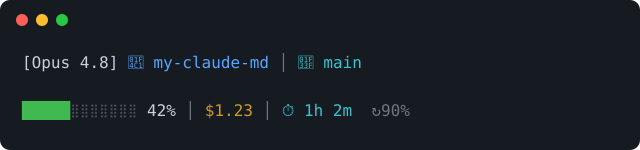

# my-claude-md

[](https://github.com/kr1shna4garwal/my-claude-md/actions/workflows/ci.yml)
[](LICENSE)

My Claude Code setup: one `CLAUDE.md`, one `settings.json`, one statusline, and five skills.

The core rule: Claude does not grade its own work. A test, a benchmark, or a reproduction has to say the result is right.



## Install

```bash
curl -fsSL https://raw.githubusercontent.com/kr1shna4garwal/my-claude-md/main/install.sh | bash
```

Needs `jq`, and `npx` for the skills. Every file it replaces in `~/.claude` is backed up first.

| Option | What it does |
| --- | --- |
| `--dry-run` | Print the changes and stop. |
| `--no-skills` | Skip the skills. |
| `--settings` | Also merge my `settings.json` into yours. |
| `--uninstall` | Restore the most recent backup. |

Without `--settings`, the installer sets only the `statusLine` key in your `settings.json`. Read [`claude/settings.json`](claude/settings.json) before you merge it: it starts sessions in auto permission mode and forces claude.ai login.

## What is inside

| File | What it is |
| --- | --- |
| [`claude/CLAUDE.md`](claude/CLAUDE.md) | Global instructions: ambition tiers, writing rules, chat style, commit format. |
| [`claude/settings.json`](claude/settings.json) | Model, effort, permissions, statusline. |
| [`claude/hooks/statusline.sh`](claude/hooks/statusline.sh) | Two lines: model, folder, branch, context bar, cost, time, cache hit rate. |

`claude/` mirrors `~/.claude/`, so you can copy files by hand.

## The Ambition section

Every request lands in one of three tiers, and Claude picks one without talking about it.

| Tier | When | What Claude does |
| --- | --- | --- |
| None | A lookup, a typo, a command. | Exactly that. |
| Quiet | A bug, a feature, a review. | What was asked, to a professional standard. |
| Full | An outcome with no finish line, or "be ambitious". | States its plan in five lines, then climbs as far as it can verify. |

Ambition raises the standard, not the permissions. Anything that spends money, cannot be undone, or is visible to others still needs a yes first.

## Credits

- The Ambition section is built on Felix Rieseberg's [How to be more ambitious: A tutorial for humans with models](https://felixrieseberg.com/how-to-be-more-ambitious-a-tutorial-for-humans-with-models/).
- Skills, installed from their own repos: [caveman](https://github.com/JuliusBrussee/caveman) (also `caveman-commit` and `caveman-compress`), [i-have-adhd](https://github.com/ayghri/i-have-adhd), [unlazy](https://github.com/Leonxlnx/unlazy).

## License

[MIT](LICENSE). The skills keep their own licenses.
